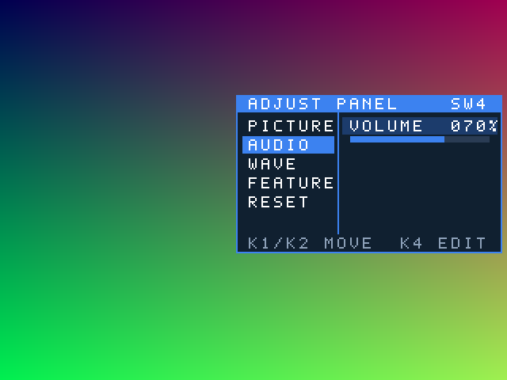
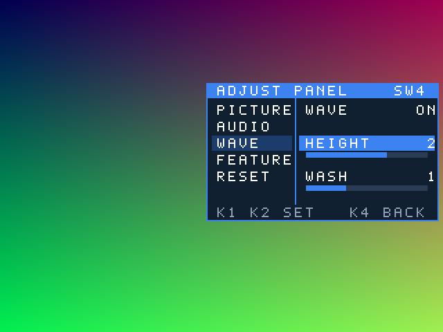

# v0.27.0 S1 候选 1：SW4 独立调节面板（Seed 13）

候选 `v0.27.0-s1-local.1`，源码提交 `48affcb`，构建 `adj27_td2_s13`，基线 v0.26.0-s1-local.1（板测通过）。[阶段计划](../../../docs/独立调节面板v0.27分阶段计划.md)。

**卡不用换**：沿用现在的卡（s5-card.2）。

## 改了什么

新增拨码开关 **SW4（C5，拨上=开）**。任何模式下拨上，右侧滑出一块调节面板；拨下滑回去，按键恢复原来的作用。

 

（预览是真实 RTL 仿真输出：[光标态](preview/panel_cursor.png)、[编辑态](preview/panel_edit.png)。）

- 版式：左栏分类，右栏条目、数值和数值条；底色 102030、蓝色 3c82f0、白字，和现有 OSD 一致。面板 336×200，位于 x=298..633、y=120..319，8 帧滑入/滑出。
- 光标态（左栏蓝底）：KEY1/KEY2 上下移动，10 项循环；KEY4 短按进入编辑。
- 编辑态（条目蓝底）：KEY1 减、KEY2 加，开关项 KEY1=OFF、KEY2=ON；KEY4 短按返回；KEY1+KEY2 同按恢复这一项的默认值。
- RESET 项：KEY4 **长按 1 s** 恢复全部默认值。
- 面板打开时按键只归面板管：不翻页、不重扫、不切 AUTO。SW3 菜单打开时先归菜单，菜单退出后面板才接管。

| 分类 | 条目 | 范围 / 默认 | 作用 |
|---|---|---|---|
| PICTURE | BRIGHT、CONTRAST | 0..255 / 128 | 和 SW1/SW2 调的是同一组值 |
| AUDIO | VOLUME | 0..100% / 100% | 同上 |
| WAVE | WAVE | ON/OFF / ON | 宣讲底部波形 |
| | HEIGHT | 0..3 / 3 | 柱高 ×(n+1)/4；3 等于 v0.26 |
| | WASH | 0..3 / 2 | 蓝色渐变深浅；2 等于 v0.26 |
| FEATURE | OSD | ON/OFF / ON | 左上角状态行 |
| | SCROLL | ON/OFF / ON | 滚动字幕及其半透明底带 |
| | FADE | ON/OFF / ON | 换图淡入/擦除；OFF 时直接切换 |
| RESET | HOLD K4 | — | 全部恢复默认 |

参数在复位后回到默认值，不保存到卡上。

## 本地结果

| 项 | v0.26.0-s1-local.1 | 本候选 |
|---|---:|---:|
| LUT | 16730（85.36%） | 17560（89.59%），+830 |
| 寄存器 | 10056 | 10295 |
| DSP | 15 | 16 |
| Setup / Hold (ns) | +0.145 / +0.003 | +0.111 / +0.075，STNS/HTNS=0 |

新模块 LUT：面板显示 556、面板按键 77、SW4 去抖 32；跨时钟邮箱加宽后共 72。同一份源码跑了 5 个种子：13 和 21 时序通过（21：+0.112 / +0.011，产物在 `diagnostics/output/adj27_td2_s21`）；7、43、47 没过（−0.313 setup / −0.008 hold / −0.002 hold），最差路径都在 SD 时钟域原有的 cache/菜单逻辑。

## 验证

- `diagnostics/adjust_panel/run_unit.ps1`（新增）：面板按键手势（短按/长按/同按/不占用时无输出）、面板状态（光标循环、编辑、单项恢复、全部重置、SW4 关闭时原 mode 1/2 行为不变）、像素（关闭时原样输出、颜色、滑入滑出）、RTL 渲染 BMP 预览。
- 回归：`media_adjust/run_unit.ps1` 6 项、`bottom_waveform/run_unit.ps1` 4 项、`run_integration.ps1` 3 项（生产 top 逐像素）、`lut_opt25/run_s1_keys.ps1` 12 项且 4 个变异全部检出、`lut24/run_sd_pin_boot.ps1` 通过。
- 复位审计（`validation/reset_audit.txt`）：新模块的异步复位都由复位同步寄存器驱动。表中 `mux3_syn_26` 是 u_hazard 的同步 SR（输入选择），`u_reset_panel` 是数码管计时器，两者只是和面板逻辑装在同一个 slice 里，不是新问题。
- `audio_vis/run_gate.ps1`、`disaster_selector/run_mode_key_equivalence.ps1`、`publicity_mode/run_m5.ps1` 在 main 上本来就跑不过（缺导出工具或生成文件），这次没有作为依据。

## 上板检查

1. 烧录本目录 [demo.bit](demo.bit)（675020 字节），卡不用换。**先确认 SW4 在下面（关）**，开机和 v0.26 应完全一样。
2. 拨上 SW4：面板从右侧滑入；拨下滑出。在图片、宣讲、情景三种画面各试一次。
3. 逐项调：亮度、对比度、音量有变化；WAVE 关掉后宣讲底部波形消失；HEIGHT 0..3 柱子变矮变高；WASH 0..3 蓝色深浅变化；OSD 关掉后左上状态行消失；SCROLL 关掉后滚动字幕消失；FADE 关掉后换图直接切换。
4. KEY1+KEY2 同按恢复单项；移到 RESET，KEY4 长按 1 s 全部恢复。
5. 面板打开时按 KEY1/KEY2/KEY4，图片不翻页、不重扫、不切 AUTO。拨下 SW4 后按键恢复正常。
6. 先拨 SW3 进菜单再拨 SW4：菜单照常用，退出菜单后面板接管。SW1/SW2 的 mode 1/2 调节照常。

回退：[v0.26.0-s1-local.1](../../v0.26.0/s1-local.1/README.md)。
